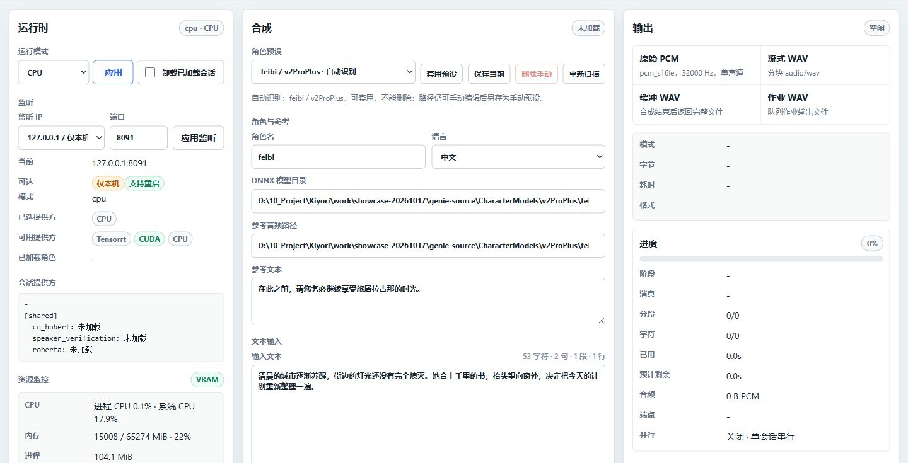
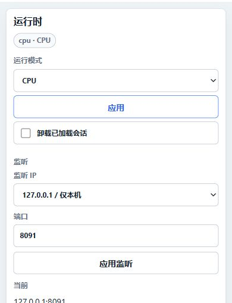

# Genie-TTS-GPU 项目展示与复核

本项目基于 Genie-TTS／GPT-SoVITS 开源生态，将推理能力整理为 Windows 本地语音工作台与可调用服务。
重点是运行环境、任务服务、客户端兼容和可检查状态；模型训练与基础推理算法属于相应上游。

## 实际界面

截图日期为 2026-10-17，页面基于公开提交 `7f3885c` 加本轮运行模式显示修复。服务只监听本机，选择 CPU，未加载角色。
截图可以证明界面和状态呈现，不证明音质、GPU 性能或客户端长期稳定性。

## 代表工作与复核入口

| 工作 | 可以检查的内容 |
| --- | --- |
| Windows 运行环境整合 | 包内 Python、依赖、CUDA DLL 与模型路径边界；`Scripts/verify-internal-runtime.ps1` |
| 推理服务与状态 | CPU/CUDA 选择、实际 ONNX session providers、健康与忙碌状态 |
| 长文本任务 | 提交、查询、取消、进度与最终有序 WAV；`/jobs/tts` 和任务验证脚本 |
| 阅读器兼容 | 原始 PCM、分块 WAV 与完整 buffered WAV 的差别，以及 Legado 样例 |
| WebUI | 模型/参考设置、输入、生成、输出、任务与诊断；从同一 HTTP API 消费状态 |

相关增量可以结合 Git 历史与[架构说明](Architecture.md)复核，不以仓库总提交数或总行数代替个人贡献。

本轮修复首次打开页面时默认 CUDA 与服务实际 CPU 模式不一致的显示问题；定时刷新保留尚未应用的用户选择。
可用 Node.js 运行 `node Scripts/test-webui-runtime-selection.cjs`，覆盖首次同步、轮询保留草稿和首次响应前的选择竞争。
该检查不加载模型，也不能替代真实浏览器或 TTS 内容验证。

## 可复查的演示路径

1. 按[README](../README_zh.md)准备真实包内环境和自己有权使用的模型、参考音频。源码下载本身不包含这些资源。
2. 仅本机演示可运行 `go-webui.bat --host 127.0.0.1 --runtime cpu --no-open`；有 CUDA 环境时再显式选择 `cuda`。
3. 在运行时区域确认模式，加载模型后检查实际 session providers，不能只看“可用提供方”。
4. 设置角色、模型目录、参考音频及对应文本，使用一段自行编写的中文完成“加载 + 参考”。
5. 先选完整 WAV 生成并试听，核对是否漏字、错读或分句异常；保存耗时与运行环境。
6. 长文本用作业接口，检查分段顺序、取消与最终 WAV；阅读器按 buffered 示例配置后另做客户端验证。

CPU、GPU、HTTP 音频结构、中文内容正确性和手机播放应分别记录。
未经同条件测试，不宣称加速倍数或普遍音质提升。

## 边界与后续工作

- 本地 HTTP 服务不自带公网身份与访问控制，不直接暴露到不可信网络。
- 模型及参考音频不随仓库分发，展示音频前单独核对使用权限。
- 不支持的运行环境、未加载模型、未完成任务应保留真实状态。
- 详细 API、并发及格式限制以[API 合同](API-Service.md)为准。
- 当前工作侧重服务和集成，后续性能工作需先形成 CPU/GPU 同条件基线。
